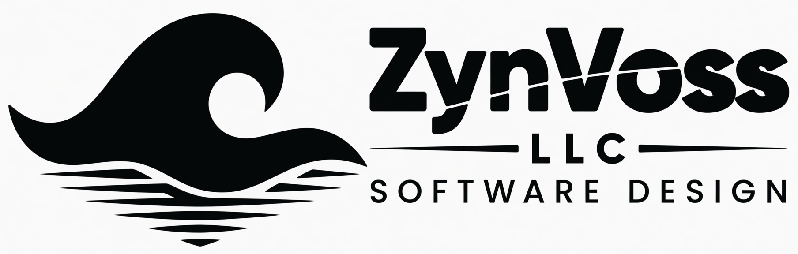

<p align="left">
  
</p>

# ZynVoss Cursor kit

ZynVoss LLC is a founder-led software company in Fort Pierce, Florida. Cursor is how we write, review, and ship production software.

This repository is the company Cursor kit: agent instructions, project rules, and a short note on how we work. Open it in Cursor. The rules load with the repo.

There is no formal Cursor partnership yet. This kit is the working baseline we want that conversation to start from.

## Company

| | |
|---|---|
| Legal name | ZynVoss LLC |
| Site | [zynvoss.com](https://www.zynvoss.com) |
| Portal | [portal.zynvoss.com](https://portal.zynvoss.com) |
| CEO | Christopher Gilliland |
| Office | 6515 Spanish Lakes Blvd, Fort Pierce, FL 34951 |
| Email | [info@zynvoss.com](mailto:info@zynvoss.com) |
| Phone | [(772) 297-1336](tel:+17722971336) |

## What lives here

```
AGENTS.md                         Always-on instructions for coding agents
.cursor/rules/zynvoss.mdc         Company defaults
.cursor/rules/engineering.mdc     How we write and change code
.cursor/rules/voice.mdc           How copy and comments should read
docs/how-we-use-cursor.md         Daily use
docs/contact-cursor-team.md       Note for Cursor’s team
```

## Open in Cursor

1. Clone this repository.
2. File → Open Folder → this directory.
3. Confirm `.cursor/rules` and `AGENTS.md` are active in Cursor Settings → Rules.

## Contact

Christopher Gilliland, President & CEO  
ZynVoss LLC  
info@zynvoss.com · (772) 297-1336  
https://www.zynvoss.com
